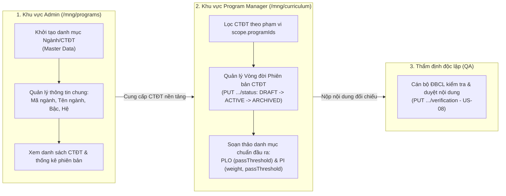
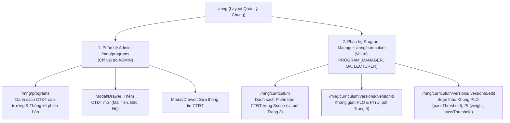

# Kế hoạch Thiết kế & Hiện thực UI cho F02: Quản lý CTĐT (Admin) & Chuẩn đầu ra PLO/PI (Program Manager)

> **Tài liệu Kế hoạch Kỹ thuật UI Angular**  
> **Dự án Frontend:** `LMS-UI` (Angular 21, TypeScript, Ng-Zorro-Antd)  
> **Dự án Backend:** `LMS-API` (Java 25, Spring Boot 4.1.2, MongoDB, Schema v0.7)  
> **Căn cứ kiến trúc:** [ADR 0005](file:///D:/Code/Project/LMS-API/doc/adr/0005-phan-quyen-khoi-tao-danh-muc-ctdt.md), [ADR 0004](file:///D:/Code/Project/LMS-API/doc/adr/0004-qa-xac-nhan-ctdt-plo.md), [ADR 0012](file:///D:/Code/Project/LMS-API/doc/adr/0012-bo-quy-doi-irm.md), [ADR 0014](file:///D:/Code/Project/LMS-API/doc/adr/0014-tinh-gon-vai-tro-va-quy-trinh-obe-v07.md)  
> **Giao diện tham khảo:** [`doc/UI.pdf`](file:///D:/Code/Project/LMS-UI/doc/UI.pdf) (Trang 3, 4, 9, 10, 36)

---

## 1. Phân định Trách nhiệm Nghiệp vụ (Separation of Concerns)

Theo mô hình quản trị đại học chuẩn tắc (Master Data Governance) và các quyết định kiến trúc **ADR 0004, 0005, 0012, 0014**:



1. **Quản trị viên (`ADMIN`):**
   - Chịu trách nhiệm khởi tạo danh mục Ngành đào tạo cấp trường (`programs`).
   - Quyền API: `POST /api/v1/programs`, `PUT /api/v1/programs/{id}`, `GET /api/v1/programs`.
   - **Tuyệt đối không can thiệp chuyên môn:** Admin không soạn thảo phiên bản, không thêm/sửa PLO, PI.

2. **Quản lý CTĐT (`PROGRAM_MANAGER`):**
   - Chịu trách nhiệm toàn bộ nội dung học thuật chuyên môn của CTĐT được phân công (`scope.programIds`).
   - Quyền API:
     - Tạo/sửa metadata phiên bản CTĐT: `POST/PUT /api/v1/program-versions`.
     - Chuyển trạng thái vòng đời (`DRAFT -> ACTIVE -> ARCHIVED`): `PUT /api/v1/program-versions/{id}/status`.
     - Quản lý danh mục PLO: `GET/POST/PUT/DELETE /api/v1/program-versions/{pvId}/plos` (bắt buộc `passThreshold`).
     - Quản lý chỉ số PI: `GET/POST/PUT/DELETE /api/v1/plos/{ploId}/pis`, `PUT/DELETE /api/v1/pis/{id}` (bắt buộc `passThreshold` và `weight`).
   - **Tách bạch thẩm định:** PM soạn thảo nội dung nhưng **không tự duyệt** trạng thái ĐBCL (`verification`).

3. **Cán bộ Đảm bảo chất lượng (`QA`):**
   - Độc lập thẩm định và cập nhật trạng thái xác thực nội dung: `PUT /api/v1/program-versions/{id}/verification` (US-08).

---

## 2. Bất biến nghiệp vụ bắt buộc trên UI (Domain Invariants)

| Bất biến nghiệp vụ | Hiện thực trên giao diện Angular |
|---|---|
| **Dữ liệu thiếu ≠ 0** | Khi dữ liệu đo lường hoặc nội dung chưa có, hiển thị dấu gạch `—` ("Chưa có dữ liệu" / "Chưa nhập"). Cấm tuyệt đối việc hiển thị số `0` hoặc 0%. |
| **Bỏ ma trận I/R/M (ADR 0012)** | Đã gỡ bỏ hoàn toàn ma trận `I/R/M` (`/pi-contributions`). Việc tính toán PI dựa trực tiếp vào liên kết `CLO -> PI` (kèm trọng số `weight`) và trọng số của từng PI trong PLO. |
| **Bắt buộc `passThreshold` & `weight` (v0.7)** | - **PLO:** Bắt buộc nhập `passThreshold` ∈ `[0.0, 1.0]` (mặc định gợi ý `0.5`).<br>- **PI:** Bắt buộc nhập `passThreshold` ∈ `[0.0, 1.0]` và `weight` ∈ `(0.0, 1.0]`. Tổng `weight` các PI trong cùng một PLO phải bằng `1.0` (100%). |
| **Thứ tự hiển thị PLO** | Danh sách PLO bắt buộc sắp theo `displayOrder` của Khoa quy định (`PLO1, PLO6, PLO7, PLO4, PLO5, PLO2, PLO3`), không sắp theo mã chuỗi hay thứ tự chèn. |
| **Khóa phiên bản `ACTIVE`** | Phiên bản đã ở trạng thái `ACTIVE` (Đang áp dụng) thì bị khóa không cho sửa đè. Người dùng muốn thay đổi phải bấm nút tạo phiên bản nháp mới kế thừa từ bản `ACTIVE`. |
| **Thang năng lực `capabilityLevelRaw`** | Hiển thị nguyên gốc giá trị từ 1 đến 6, không suy diễn hoặc đổi sang thang Bloom (thang Bloom chỉ dùng cho CLO ở F03). |
| **Bảo vệ mã PLO/PI** | Mã PLO/PI đã lưu vào CSDL không được phép sửa (trường input bị `disabled`) vì liên kết đo lường và điểm số đang tham chiếu đến mã này. Dòng mới thêm phải kiểm tra regex: PLO theo `^PLO[1-9][0-9]*$`, PI theo `^PI[1-9][0-9]*\.[1-9][0-9]*$`. |
| **Cảnh báo dữ liệu thử nghiệm** | Luôn hiển thị huy hiệu `DỮ LIỆU THỬ NGHIỆM` trên header của toàn bộ hệ thống. |

---

## 3. Kiến trúc Điều hướng & Định tuyến Route (Angular Routes)

Trong layout quản lý `/mng`, hệ thống chia thành 2 phân hệ rõ ràng:



### Chi tiết cấu hình Router Guards & Role-based Data:
1. **Phân hệ Admin:**
   ```typescript
   {
     path: 'programs',
     canActivate: [canActiveGuard],
     data: { listRoles: [SystemConstant.MNG_ROLE.ADMIN], rolesRelation: 'OR' },
     loadChildren: () => import('./programs/programs.routes').then(m => m.programsRoutes),
     title: `Quản lý Danh mục CTĐT | ${SystemConstant.WEB_NAME}`,
   }
   ```
2. **Phân hệ Program Manager (Khung CTĐT & Chuẩn đầu ra):**
   ```typescript
   {
     path: 'curriculum',
     canActivate: [canActiveGuard],
     data: {
       listRoles: [
         SystemConstant.MNG_ROLE.PROGRAM_MANAGER,
         SystemConstant.MNG_ROLE.QA,
         SystemConstant.MNG_ROLE.LECTURER,
       ],
       rolesRelation: 'OR',
     },
     loadChildren: () => import('./curriculum/curriculum.routes').then(m => m.curriculumRoutes),
     title: `Khung CTĐT & Chuẩn đầu ra | ${SystemConstant.WEB_NAME}`,
   }
   ```

---

## 4. Chi tiết Thiết kế Giao diện Người dùng

### 4.1. Phân hệ Admin: Quản lý Danh mục CTĐT (`/mng/programs`)
*Dành riêng cho Quản trị viên quản lý danh mục Ngành cấp trường (Master Data).*

- **Tiêu đề trang:** `Danh mục Chương trình Đào tạo`
- **Mô tả:** *"Khởi tạo và quản lý danh mục các ngành, chương trình đào tạo của trường. Cán bộ quản lý CTĐT sẽ phụ trách nội dung chi tiết của từng phiên bản."*
- **Nút hành động:** `+ Thêm chương trình đào tạo` (Mở modal nhập liệu).
- **Bảng dữ liệu CTĐT (`nz-table`):**
  - Cột 1 — **Mã chương trình/ngành:** (ví dụ: `CNTT`, `FINTECH`, `7480201`).
  - Cột 2 — **Tên chương trình:** (ví dụ: `Công nghệ thông tin`, `Công nghệ tài chính`).
  - Cột 3 — **Trình độ đào tạo (`level`):** (ví dụ: `Đại học`, `Thạc sĩ`, `Tiến sĩ`).
  - Cột 4 — **Loại văn bằng (`degree`):** (ví dụ: `Kỹ sư`, `Cử nhân`).
  - Cột 5 — **Số phiên bản hiện có:** Hiển thị số lượng phiên bản (`badge` đếm số bản `DRAFT`, `ACTIVE`, `ARCHIVED`).
  - Cột 6 — **Thao tác:**
    - Nút `Sửa` (chỉnh sửa tên, bậc, hệ của CTĐT).
    - Nút `Xem phiên bản` (dẫn nhanh sang trang quản lý phiên bản ở chế độ xem).
- **Modal Thêm/Sửa CTĐT (`ProgramModalComponent`):**
  - Form kiểm soát dữ liệu:
    - `Mã chương trình (code)`: Bắt buộc, không dấu, viết hoa (ví dụ: `FINTECH`). Khóa không cho sửa khi cập nhật.
    - `Tên chương trình (name)`: Bắt buộc, từ 2 đến 200 ký tự.
    - `Bậc đào tạo (level)`: Dropdown chọn `Đại học` / `Sau đại học`.
    - `Loại bằng (degree)`: Dropdown chọn `Kỹ sư` / `Cử nhân` / `Thạc sĩ`.
  - Validate lỗi tức thời dưới từng ô nhập liệu.

---

### 4.2. Phân hệ Program Manager: Khung CTĐT, Phiên bản & PLO/PI (`/mng/curriculum`)
*Dành cho Quản lý CTĐT (soạn thảo chuyên môn) và Cán bộ ĐBCL (thẩm định).*

#### Màn hình 1: Quản lý Phiên bản CTĐT (`/mng/curriculum`)
*(Tham chiếu bố cục Trang 3 `UI.pdf`)*
- **Header:**
  - Bộ chọn CTĐT (Program Selector): Dropdown lọc các CTĐT nằm trong `scope.programIds` của Quản lý CTĐT hiện tại.
  - Phụ đề: `BM7A-2.7-Updated-2026 · Ngành Công nghệ thông tin`.
  - Nút hành động: `+ Phiên bản mới` (Button nổi bật, mở modal tạo phiên bản nháp).
- **Thanh Tab:** `[Phiên bản] (Active)` | `PLO · PI` | `Học phần` | `CLO · Đề cương` | `Liên kết CLO–PI`
- **Khối cảnh báo nghiệp vụ (`nz-alert` info):**
  - *"Chương trình đang áp dụng không sửa trực tiếp được. Sửa bản đang áp dụng sẽ tạo phiên bản nháp mới, bản cũ vẫn giữ để đọc lại báo cáo."*
- **Bảng danh sách các phiên bản CTĐT:**
  - Cột 1 — **Phiên bản:** Mã phiên bản (ví dụ: `BM7A-2.8-Draft`, `BM7A-2.7-Updated-2026`). Chip xám `"đang xem"` gắn vào phiên bản đang làm việc.
  - Cột 2 — **Trạng thái:** Dùng widget `app-status-chip` hiển thị 3 trạng thái:
    - `Nháp` (`DRAFT` - cam)
    - `Đang áp dụng` (`ACTIVE` - xanh lá)
    - `Đã lưu trữ` (`ARCHIVED` - xám)
  - Cột 3 — **Áp dụng từ:** Học kỳ bắt đầu áp dụng (ví dụ: `2026-HK1`). Bản nháp hiển thị `—`.
  - Cột 4 — **Số lượng PLO:** Thống kê số PLO đã tạo (ví dụ: `7`).
  - Cột 5 — **Số lượng PI:** Thống kê số PI đã tạo (ví dụ: `17`).
  - Cột 6 — **Thao tác:**
    - Bản `DRAFT`: Nút `Sửa` (chuyển sang trang soạn thảo), nút `Áp dụng` (chuyển trạng thái sang `ACTIVE`).
    - Bản `ACTIVE`: Nút `Xem`, nút `Tạo bản nháp mới từ bản này` (nhân bản nội dung để sửa đổi an toàn).
    - Bản `ARCHIVED`: Nút `Xem` (chỉ đọc lịch sử).

---

#### Màn hình 2: Không gian làm việc PLO & PI (`/mng/curriculum/versions/:versionId`)
*(Tham chiếu bố cục Trang 4 `UI.pdf`)*
- **Header:**
  - Tiêu đề: `Chương trình đào tạo — Khung Chuẩn đầu ra`
  - Thông tin phiên bản: Mã phiên bản, trạng thái (`DRAFT`/`ACTIVE`/`ARCHIVED` + nút đổi trạng thái qua `PUT .../status`), tổng số tín chỉ, thời gian đào tạo.
  - Nút hành động: `Sửa chương trình` (dành cho PM có quyền ghi), `Duyệt nội dung` (dành cho `QA`).
- **Phần A — Danh sách Chuẩn đầu ra PLO & Chỉ số PI (Tree Table):**
  - Hiển thị cấu trúc cây 2 cấp:
    - **Cấp 1 (PLO):** Hiển thị các PLO theo đúng thứ tự `displayOrder`. Cột Mức năng lực (1–6, dùng `app-level-label`), Cột Ngưỡng đạt (`passThreshold` — bắt buộc ∈ `[0, 1]`), Cột Nguồn nội dung (`Diễn giải tạm` hoặc `Đã đối chiếu bản gốc`). Nội dung nếu chưa có thì hiển thị dấu `—`.
    - **Cấp 2 (PI):** Các chỉ số hiệu năng trực thuộc từng PLO (`PI6.1, PI6.2, PI6.3...`). Cột **Trọng số (`weight`)** (tổng các PI trong cùng PLO = `1.0`) và Cột **Ngưỡng đạt (`passThreshold`)**.
- **Phần B — Khối Thẩm định ĐBCL (US-08):**
  - Hiển thị badge kiểm chứng: `CHƯA XÁC NHẬN` / `ĐÃ XÁC NHẬN` / `CẦN LÀM RÕ`.
  - Nếu là `QA`: Hiển thị nút `Duyệt nội dung` (mở popup chọn trạng thái và nhập ghi chú thẩm định).
  - Nếu là `PROGRAM_MANAGER` hoặc các vai trò khác: Chỉ hiển thị trạng thái và người đã duyệt, nút duyệt bị ẩn hoặc disabled.

---

#### Màn hình 3: Soạn thảo Khung Chương trình & PLO/PI (`.../edit`)
*(Tham chiếu bố cục Trang 9, 10 `UI.pdf`)*
- **Header:**
  - Tiêu đề: `Sửa chương trình đào tạo & Chuẩn đầu ra`
  - Thông báo: *"Thay đổi chỉ có hiệu lực sau khi bấm Lưu. Sửa bản đang áp dụng sẽ tạo phiên bản nháp mới."*
- **Form 1: Thông tin cấu trúc phiên bản:**
  - Tên phiên bản (`version`), Tổng tín chỉ (`totalCredits`), Thời gian đào tạo theo năm (`durationYears`), Khóa áp dụng (`applicableCohorts`).
- **Form 2: Soạn thảo danh mục PLO và PI dạng cây (`FormArray`):**
  - Từng dòng PLO:
    - Mã PLO: Input text. Nếu là bản ghi cũ -> `disabled`. Nếu là bản ghi mới -> tự động validate regex `^PLO[1-9][0-9]*$`.
    - Thứ tự hiển thị (`displayOrder`): Number input.
    - Phân loại (`category`): Dropdown `Đại cương` / `Chuyên ngành`.
    - Mức năng lực (`capabilityLevelRaw`): Dropdown chọn 1 đến 6.
    - Nguồn nội dung: Dropdown `Diễn giải tạm` / `Đã đối chiếu bản gốc`.
    - Nội dung nguyên văn / tóm tắt: Textarea.
  - Từng dòng PI (nằm trong khối PLO cha):
    - Mã PI: Validate regex `^PI[1-9][0-9]*\.[1-9][0-9]*$`. Mã cũ -> `disabled`.
    - Mức năng lực: Dropdown 1 đến 6.
    - Tỷ lệ đạt kỳ vọng (`targetPassRate`): Number input (0 - 100%).
    - Nội dung PI: Textarea.
  - Nút thêm: `+ Thêm PI cho PLO...` và `+ Thêm PLO`.
- **Thanh công cụ cố định chân trang (Sticky Action Bar):**
  - Trái: Báo lỗi validation trực quan (ví dụ: `• Dòng PLO mới chưa có mã`, `• Mã PI sai định dạng`).
  - Phải: Nút `Hủy thay đổi` và nút `Lưu thay đổi` (Primary, tự động kiểm tra tính hợp lệ trước khi submit).

---

## 5. Tổ chức Thư mục Mã nguồn tại `LMS-UI`

```
src/app/
├── core/
│   ├── constants/
│   │   └── url.constant.ts                  <-- Khai báo PROGRAMS, PROGRAM_VERSIONS, PLOS, PIS, CONTRIBUTIONS
│   ├── models/
│   │   └── program/
│   │       ├── program.model.ts             <-- IProgram, IProgramRequest (Dành cho Admin)
│   │       ├── program-version.model.ts     <-- IProgramVersion, VersionStatus
│   │       ├── plo-pi.model.ts              <-- IPlo, IPi, ICoursePiContribution
│   │       └── program-verification.model.ts<-- IVerificationRequest, VerificationStatus (US-08)
│   └── services/
│       └── program/
│           ├── program.service.ts           <-- CRUD Programs (Admin)
│           ├── program-version.service.ts   <-- CRUD Versions & Scope handling (PM)
│           ├── plo-pi.service.ts            <-- CRUD PLO, PI, Matrix I/R/M (PM)
│           └── program-verification.service.ts <-- API xác thực ĐBCL (QA Officer)
│
├── layout/
│   └── mng/management-sidebar/
│       └── management-sidebar.component.ts  <-- Tích hợp cả 2 mục menu vào Sider
│
└── mng/
    ├── programs/                            <-- 1. PHÂN HỆ ADMIN: Quản lý danh mục CTĐT
    │   ├── programs.menu.ts                 <-- Menu item "Danh mục CTĐT" (roles: [ADMIN])
    │   ├── programs.routes.ts               <-- Route /mng/programs
    │   ├── list-programs/                   <-- Danh sách CTĐT cấp trường
    │   └── program-modal/                   <-- Modal tạo/sửa CTĐT (code, name, level, degree)
    │
    └── curriculum/                          <-- 2. PHÂN HỆ PROGRAM MANAGER: Khung CTĐT & CĐR
        ├── curriculum.menu.ts               <-- Menu item "Khung CTĐT & Chuẩn đầu ra" (roles: [PM, QA, LEC])
        ├── curriculum.routes.ts             <-- Routes: list versions, detail PLO/PI, edit
        ├── list-curriculum-versions/        <-- Danh sách phiên bản trong scope (UI.pdf Trang 3)
        ├── detail-curriculum-version/       <-- Không gian PLO/PI (UI.pdf Trang 4)
        │   ├── plo-pi-tree-table/           <-- Cây phân cấp PLO / PI (kèm weight, passThreshold)
        │   └── verification-action-modal/   <-- Popup duyệt ĐBCL (US-08 dành cho QA)
        └── form-curriculum-version/         <-- Màn hình soạn thảo phiên bản & PLO/PI (UI.pdf Trang 9, 10)
```

---

## 6. Kế hoạch Kiểm thử & Đảm bảo Chất lượng

### 6.1. Kiểm thử tự động (Automated Verification)
1. **Kiểm tra Lint:**
   ```bash
   cd D:\Code\Project\LMS-UI
   npm run lint
   ```
   *Yêu cầu:* 0 lỗi ESLint, strictly typed (không dùng `any`).
2. **Kiểm tra Unit Tests:**
   ```bash
   npm test
   ```
   *Test suites trọng tâm:*
   - `list-programs.component.spec.ts`: Admin xem được danh sách CTĐT; người dùng không phải Admin bị Guard chặn.
   - `list-curriculum-versions.component.spec.ts`: Hiển thị đúng các phiên bản thuộc CTĐT trong scope; nút "Tạo phiên bản mới" ẩn đối với vai trò chỉ xem (`QA`, `LECTURER`).
   - `detail-curriculum-version.component.spec.ts`:
     - Kiểm tra sắp xếp PLO chuẩn theo `displayOrder`.
     - Hiển thị `passThreshold` cho PLO và `weight`, `passThreshold` cho PI (không chứa giá trị mặc định sai khi thiếu dữ liệu).
     - Nút duyệt ĐBCL chỉ kích hoạt khi tài khoản có vai trò `QA`.
   - `form-curriculum-version.component.spec.ts`:
     - Validate regex mã PLO (`^PLO[1-9][0-9]*$`), mã PI (`^PI[1-9][0-9]*\.[1-9][0-9]*$`) và tổng trọng số PI trong cùng PLO = `1.0`.
     - Đảm bảo trường mã của bản ghi đã lưu trong DB ở trạng thái `disabled`.
3. **Kiểm tra Build Dev:**
   ```bash
   npm run build:dev
   ```

### 6.2. Kiểm thử luồng nghiệp vụ trên UI (Manual Verification)
1. **Luồng Admin:**
   - Đăng nhập `admin` -> Vào menu **Danh mục CTĐT** (`/mng/programs`).
   - Thêm một CTĐT mới (ví dụ: `IS - Hệ thống thông tin`) -> Lưu thành công.
   - Thử sửa tên CTĐT -> Lưu thành công.
2. **Luồng Program Manager:**
   - Đăng nhập `quanly.ctdt` -> Vào menu **Khung CTĐT & Chuẩn đầu ra** (`/mng/curriculum`).
   - Chọn CTĐT trong phạm vi -> Thấy danh sách các phiên bản (Nháp, Đang áp dụng, Đã lưu trữ).
   - Mở chi tiết một phiên bản -> Kiểm tra cây PLO / PI kèm `passThreshold` và `weight`.
   - Thử bấm **Sửa chương trình** -> Thêm một PLO mới không nhập mã -> Kiểm tra thanh cảnh báo đỏ chân trang hiển thị lỗi *"Dòng PLO mới chưa có mã"*.
3. **Luồng Cán bộ ĐBCL (`QA`):**
   - Đăng nhập `qa.01` -> Vào xem phiên bản CTĐT -> Nút **Duyệt nội dung** hiển thị cho phép cập nhật trạng thái `VERIFIED` kèm ghi chú thẩm định (US-08).

---

## 7. Nội dung Chuẩn bị Vấn đáp Bảo vệ (Rubric Mục 6.2)

1. **Mã vừa tạo làm gì?**
   - Xây dựng 2 phân hệ UI riêng biệt:
     1. Giao diện Admin quản trị danh mục Ngành đào tạo cấp trường (Master Data).
     2. Giao diện Program Manager quản lý nội dung chuyên môn của CTĐT (Vòng đời phiên bản, cây PLO / PI kèm trọng số và ngưỡng đạt) và tích hợp quy trình thẩm định ĐBCL độc lập (`QA`).
2. **Vì sao có sự phân chia giao diện Admin và Program Manager?**
   - Theo quyết định kiến trúc **ADR 0005**: Danh mục ngành là dữ liệu pháp lý dài hạn do Hội đồng trường ban hành, chỉ Admin/Phòng Đào tạo được khởi tạo. Ngược lại, nội dung chuẩn đầu ra PLO/PI là nghiệp vụ học thuật chuyên môn của Quản lý CTĐT. Phân tách rõ ràng giúp tuân thủ nguyên tắc phân định trách nhiệm (Separation of Duties) và chuẩn an toàn thông tin OWASP.
3. **Các tham số, ràng buộc và thư viện đến từ đâu?**
   - Thư viện: Angular 21, `ng-zorro-antd`, FontAwesome.
   - Ràng buộc: Regex mã PLO/PI, các enum trạng thái phiên bản (`DRAFT`, `ACTIVE`, `ARCHIVED`), ngưỡng đạt `passThreshold`, trọng số `weight` (bỏ I/R/M theo ADR 0012) và quy trình thẩm định đồng bộ 100% với Spring Boot backend `LMS-API` và Schema v0.7 (`GiaiThich_CoSoDuLieu.md`).
4. **Nếu bỏ mô-đun này đi thì hệ thống bị ảnh hưởng gì?**
   - Nếu không có UI Admin: Không thể tạo ngành mới để cấp scope cho người dùng.
   - Nếu không có UI Program Manager: Không thể thiết lập và cập nhật khung chuẩn đầu ra phiên bản hóa; toàn bộ chuỗi đo lường (CLO → PI → PLO) bị mất dữ liệu tham chiếu gốc và không thể tiến hành đo lường hay lập báo cáo kiểm định.
