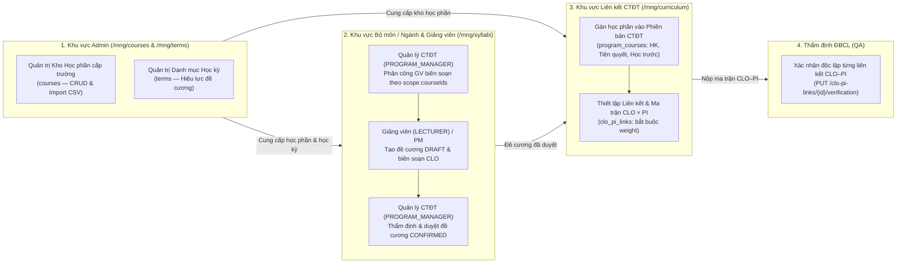
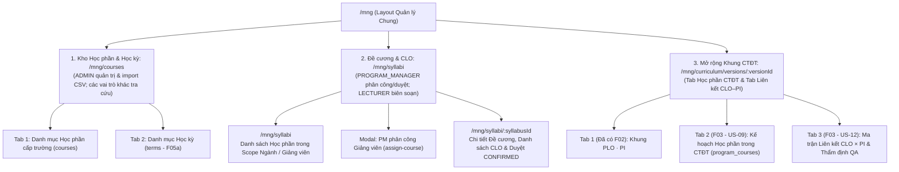

# Kế hoạch Thiết kế & Hiện thực UI cho F03: Học phần, Đề cương, CLO & Liên kết CLO–PI (kèm Quản lý Học kỳ F05a)

> **Tài liệu Kế hoạch Kỹ thuật UI Angular**  
> **Dự án Frontend:** `LMS-UI` (Angular 21, TypeScript, Ng-Zorro-Antd)  
> **Dự án Backend:** `LMS-API` (Java 25, Spring Boot 4.1.2, MongoDB)  
> **Căn cứ kiến trúc:** [ADR 0010](file:///D:/Code/Project/LMS-API/doc/adr/0010-phan-quyen-de-cuong-theo-bo-mon-va-giang-vien.md), [ADR 0004](file:///D:/Code/Project/LMS-API/doc/adr/0004-qa-xac-nhan-ctdt-plo.md), [F03-hoc-phan-clo.md](file:///D:/Code/Project/LMS-API/doc/plan/F03-hoc-phan-clo.md), [F05a-hoc-ky-lop-sinh-vien.md](file:///D:/Code/Project/LMS-API/doc/plan/F05a-hoc-ky-lop-sinh-vien.md)  
> **Giao diện tham khảo:** [`doc/UI.pdf`](file:///D:/Code/Project/LMS-UI/doc/UI.pdf) (Trang 5, 6, 7, 8, 11, 12)

---

## 1. Phân định Trách nhiệm Nghiệp vụ (Separation of Concerns theo ADR 0010 & ADR 0014)

Theo mô hình phân quyền 4 vai trò cốt lõi (**ADR 0014**), luồng nghiệp vụ F03 tách bạch rõ ràng giữa 4 vai trò:



1. **Quản trị viên (`ADMIN`):**
   - Quản lý độc quyền Danh mục Học phần cấp trường (`courses` — Master Catalog): Tạo mới (`POST /api/v1/courses`), cập nhật (`PUT /api/v1/courses/{id}`), xóa học phần chưa có tham chiếu (`DELETE /api/v1/courses/{id}`), và **nhập hàng loạt từ CSV** (`POST /api/v1/courses/import`).
   - Quản lý Danh mục Học kỳ (`terms` — thuộc F05a, đã triển khai trước làm cơ sở cho thời hạn hiệu lực đề cương).
   - Quản lý tài khoản và phân quyền phạm vi (`/mng/users`): Cấp `scope.courseIds` và `scope.programIds` cho `PROGRAM_MANAGER`, `LECTURER`, `QA`.
   - **Thu hồi quyền học thuật:** ADMIN không có thẩm quyền tạo đề cương DRAFT, chỉnh sửa CLO, phê duyệt CONFIRMED đề cương, hoặc phân công giảng viên tại `/api/v1/departments/**`.
2. **Trưởng chương trình đào tạo (`PROGRAM_MANAGER`):**
   - Phụ trách khung CTĐT nằm trong `scope.programIds` và các học phần trong `scope.courseIds`.
   - Phân công hoặc thu hồi quyền biên soạn đề cương cho Giảng viên: `GET /api/v1/departments/lecturers`, `POST /api/v1/departments/assign-course`, `POST /api/v1/departments/unassign-course`.
   - Rà soát nội dung đề cương + danh sách CLO và phê duyệt chuyển trạng thái đề cương từ `DRAFT` $\to$ `CONFIRMED` (`PUT /api/v1/syllabi/{id}/status`).
   - Đưa học phần từ kho trường vào phiên bản CTĐT (`program_courses`): cấu hình học kỳ dự kiến (`semester`), số tín chỉ (`credits`), loại học phần (`COMPULSORY`/`ELECTIVE`), phân loại khối kiến thức (`category`), học phần tiên quyết (`prerequisiteCourseIds`) và học phần học trước (`previousCourseIds`).
   - Thiết lập liên kết chuẩn đầu ra $CLO \to PI$ (`POST /api/v1/syllabi/{syllabusId}/clo-pi-links`, **bắt buộc `weight` ∈ `(0, 1]`**, tổng = `1.0` theo PI) và tra cứu ma trận $CLO \times PI$.
3. **Giảng viên (`LECTURER`):**
   - Phụ trách biên soạn đề cương cho các môn học được phân công trong `scope.courseIds`.
   - Khởi tạo phiên bản đề cương mới ở trạng thái `DRAFT` (`POST /api/v1/courses/{courseId}/syllabi`).
   - Thêm, sửa, xóa các chuẩn đầu ra học phần (`clos`) khi đề cương đang ở `DRAFT` (`POST /api/v1/syllabi/{syllabusId}/clos`, `PUT /api/v1/clos/{id}`, `DELETE /api/v1/clos/{id}`).
4. **Cán bộ Đảm bảo chất lượng (`QA`):**
   - Thẩm định chất lượng độc lập từng liên kết $CLO \to PI$ thuộc phạm vi `scope.programIds` (`PUT /api/v1/clo-pi-links/{id}/verification` — US-12/AC-3).

---

## 2. Bất biến nghiệp vụ bắt buộc trên UI (Domain Invariants)

| Bất biến nghiệp vụ | Hiện thực trên giao diện Angular |
|---|---|
| **Dữ liệu thiếu ≠ 0** | Khi tỷ trọng (`defaultWeight`), ngưỡng đạt (`defaultPassThreshold`), trọng số liên kết (`weight`), hoặc học kỳ kết thúc (`effectiveToTermId`) là `null`/`undefined`, hiển thị dấu gạch `—` ("Chưa cấu hình" / "Còn hiệu lực"). Tuyệt đối không hiển thị `0` hay `0%` mặc định (Q12, Q22). |
| **Mức Bloom (1–6) ≠ Điểm số** | `bloomLevel` ∈ `{1..6}` biểu thị bậc nhận thức Bloom sửa đổi (Nhớ, Hiểu, Áp dụng, Phân tích, Đánh giá, Sáng tạo). Hiển thị qua widget `app-level-label`, tuyệt đối không có ô quy đổi ra thang điểm. |
| **Mã CLO chỉ duy nhất trong 1 Đề cương** | Nhận diện CLO bằng `id` (ObjectId); hai đề cương khác nhau được phép có cùng mã `CLO1`. Validate mã CLO theo regex `^CLO[0-9]+$`. |
| **Đóng băng Đề cương `CONFIRMED` / `ARCHIVED` (TD-27)** | Khi `syllabus.status !== 'DRAFT'`, khóa cứng 100% thao tác thêm/sửa/xóa CLO và thêm/xóa liên kết CLO–PI trên giao diện (ẩn hoặc `disabled` các nút chỉnh sửa). Muốn cập nhật phải bấm **"Tạo phiên bản đề cương mới"**. |
| **Ràng buộc Tiên quyết & Học trước** | Trên form `program_courses`: (1) Loại bỏ chính học phần đang xét khỏi dropdown chọn tiên quyết/học trước (chặn self-reference); (2) Không cho phép một học phần xuất hiện đồng thời ở cả `prerequisiteCourseIds` và `previousCourseIds` (`PREREQUISITE_AND_PREVIOUS_CONFLICT`). |
| **Môn học phải thuộc CTĐT trước khi nối CLO–PI (TD-28)** | Trên màn hình liên kết CLO–PI của một phiên bản CTĐT, chỉ liệt kê các học phần đã được gán vào `program_courses` của phiên bản CTĐT đó. |
| **Hiệu lực thời gian Đề cương** | Khi chọn `effectiveFromTermId` và `effectiveToTermId`, kiểm tra học kỳ kết thúc không được có ngày bắt đầu trước học kỳ bắt đầu hiệu lực (US-10/AC-2). |

---

## 3. Kiến trúc Điều hướng & Định tuyến Route (Angular Routes)

Hệ thống mở rộng layout quản lý `/mng` với các phân khu khớp theo vai trò:



### Cấu hình Route dự kiến trong `src/app/mng/mng.routes.ts`:
```typescript
{
  path: 'courses',
  canActivate: [canActiveGuard],
  data: { listRoles: ALL_MNG_ROLES, rolesRelation: 'OR' },
  loadChildren: () => import('./courses/courses.routes').then(m => m.coursesRoutes),
  title: `Danh mục Học phần & Học kỳ | ${SystemConstant.WEB_NAME}`,
},
{
  path: 'syllabi',
  canActivate: [canActiveGuard],
  data: { listRoles: ALL_MNG_ROLES, rolesRelation: 'OR' },
  loadChildren: () => import('./syllabi/syllabi.routes').then(m => m.syllabiRoutes),
  title: `Đề cương & Chuẩn đầu ra Học phần (CLO) | ${SystemConstant.WEB_NAME}`,
}
```

---

## 4. Chi tiết Thiết kế Giao diện Người dùng

### 4.1. Phân hệ Kho Học phần & Học kỳ (`/mng/courses`)
*Dành cho `ADMIN` quản trị dữ liệu gốc cấp trường; các vai trò khác có quyền xem/tra cứu.*

#### Tab A: Danh mục Học phần cấp trường (`courses` — US-09/AC-1)
- **Thanh công cụ:**
  - Ô tìm kiếm theo mã hoặc tên học phần (`search` query param, debounce 300ms).
  - Nút `+ Thêm học phần mới` (chỉ hiển thị với `ADMIN`).
- **Bảng dữ liệu (`nz-table` có phân trang server-side):**
  - **Mã học phần (`code`):** Ví dụ `OOPR230279`, `APCM220307`, `ABDA433708`.
  - **Tên học phần (`name`):** Ví dụ `Lập trình hướng đối tượng`.
  - **Số tín chỉ chuẩn (`credits`):** Số nguyên $\ge 0$ (hoặc `—` nếu chưa nhập).
  - **Thao tác:**
    - Nút `Xem đề cương` (chuyển sang `/mng/syllabi?courseId=...`).
    - Với `ADMIN`: Nút `Sửa`, Nút `Xóa` (có `nz-popconfirm`; nếu môn đã gán vào CTĐT hoặc có đề cương thì hiển thị thông báo lỗi 422 từ backend).
- **Modal Thêm/Sửa Học phần (`CourseModalComponent`):**
  - `code`: Bắt buộc, tối đa 64 ký tự, regex `^[A-Za-z0-9_.-]+$`. Khóa (`disabled`) khi ở chế độ Sửa.
  - `name`: Bắt buộc, tối đa 255 ký tự.
  - `credits`: `nz-input-number`, $\ge 0$.

#### Tab B: Quản lý Học kỳ (`terms` — F05a US-18)
- **Mục đích:** Cung cấp danh mục học kỳ để gắn mốc hiệu lực (`effectiveFromTermId`, `effectiveToTermId`) cho đề cương.
- **Bảng dữ liệu:**
  - Mã học kỳ (`code`, ví dụ `2026-HK1`), Năm học (`academicYear`, ví dụ `2026-2027`), Ngày bắt đầu (`startDate`), Ngày kết thúc (`endDate`), Trạng thái (`UPCOMING` / `ACTIVE` / `CLOSED` hiển thị qua `app-status-chip`).
- **Thao tác (`ADMIN` / `PROGRAM_MANAGER`):**
  - Thêm học kỳ mới, cập nhật thông tin, chuyển trạng thái vòng đời học kỳ (`PUT /api/v1/terms/{id}/status`).

---

### 4.2. Phân hệ Đề cương & Chuẩn đầu ra Học phần (`/mng/syllabi`)
*Không gian làm việc chuyên môn của Quản lý CTĐT (`PROGRAM_MANAGER`) và Giảng viên (`LECTURER`) theo ADR 0010 & ADR 0014.*

#### Màn hình 1: Danh sách Học phần & Phiên bản Đề cương (`/mng/syllabi`)
- **Bộ lọc đầu trang:**
  - Chọn học phần (mặc định lọc các môn nằm trong `scope.courseIds` hoặc ngành `scope.programIds`; hoặc xem toàn bộ khi bật chế độ tra cứu).
- **Khu vực Phân công Giảng viên (Dành cho `PROGRAM_MANAGER`):**
  - Nút `Phân công giảng viên biên soạn` mở `AssignCourseModalComponent`:
    - Tải danh sách giảng viên thuộc phạm vi Khoa/Ngành (`scope.programIds`) thông qua `GET /api/v1/departments/lecturers?courseId={courseId}`.
    - Chọn giảng viên (`LECTURER`) và gọi `POST /api/v1/departments/assign-course` (hoặc gỡ phân công qua `POST /api/v1/departments/unassign-course`).
- **Bảng danh sách các phiên bản Đề cương của học phần đang chọn (`GET /api/v1/courses/{courseId}/syllabi`):**
  - **Phiên bản (`version`):** Ví dụ `2026-v1`.
  - **Trạng thái (`status`):** `DRAFT` (Nháp - cam), `CONFIRMED` (Đã duyệt chính thức - xanh lá), `ARCHIVED` (Lưu trữ - xám).
  - **Hiệu lực từ học kỳ (`effectiveFromTermId`):** Hiển thị mã học kỳ tương ứng.
  - **Hiệu lực đến học kỳ (`effectiveToTermId`):** Hiển thị mã học kỳ hoặc `—` (Còn hiệu lực).
  - **Thao tác:**
    - Nút `Mở chi tiết & CLO` (dẫn tới `/mng/syllabi/:syllabusId`).
    - Nút `+ Tạo phiên bản đề cương mới` (hiển thị khi người dùng là `LECTURER` hoặc `PROGRAM_MANAGER` có quyền ghi học phần).

#### Màn hình 2: Chi tiết Đề cương & Soạn thảo CLO (`/mng/syllabi/:syllabusId`)
- **Header thông tin Đề cương:**
  - Hiển thị Mã & Tên học phần, Phiên bản đề cương, Học kỳ hiệu lực, Trạng thái `status`, và Thông tin phê duyệt (`verification.verifiedBy`, `verifiedAt`).
  - **Cảnh báo khóa (Banner):** Nếu `status !== 'DRAFT'`, hiển thị `nz-alert` thông báo: *"Đề cương đã được phê duyệt chính thức (CONFIRMED) hoặc lưu trữ. Danh sách CLO đã bị khóa để bảo toàn dữ liệu đo lường lịch sử."*
  - **Nút hành động trên Header:**
    - Với `PROGRAM_MANAGER` (trong scope):
      - Khi `status === 'DRAFT'`: Nút **`Phê duyệt Đề cương (CONFIRMED)`** (gọi `PUT /api/v1/syllabi/{id}/status` với `{ status: 'CONFIRMED' }`).
      - Khi `status === 'CONFIRMED'`: Nút `Chuyển vào Lưu trữ (ARCHIVED)`.
- **Bảng Danh sách Chuẩn đầu ra Học phần (`clos` — US-11):**
  - Cột 1 — **Mã CLO (`code`):** Ví dụ `CLO1`, `CLO2`, `CLO3` (sắp xếp tăng dần theo số thứ tự mã).
  - Cột 2 — **Nội dung nguyên văn (`contentOriginal`):** Trích xuất từ đề cương chi tiết (hiển thị `—` nếu trống).
  - Cột 3 — **Mức nhận thức Bloom (`bloomLevel` 1–6):** Hiển thị bằng widget `app-level-label` kèm ghi chú `bloomNote` (ví dụ: `Mức 3 - Áp dụng`).
  - Cột 4 — **Cấu hình đo lường mặc định (`measurement`):**
    - Tỷ trọng mặc định (`defaultWeight`) và Ngưỡng đạt (`defaultPassThreshold`). Nếu `null` thì hiển thị `—` (Chờ Khoa xác nhận - Q12).
  - Cột 5 — **Thao tác** (Chỉ hiển thị khi `syllabus.status === 'DRAFT'` và người dùng là `LECTURER` hoặc `PROGRAM_MANAGER` có quyền ghi học phần; `ADMIN` chỉ đọc):
    - Nút `Sửa CLO`, Nút `Xóa CLO`.
- **Modal Thêm/Sửa CLO (`CloModalComponent`):**
  - `code`: Bắt buộc, validate regex `^CLO[0-9]+$` (ví dụ `CLO1`, `CLO2`).
  - `bloomLevel`: Bắt buộc, chọn từ `1` đến `6` (1: Nhớ, 2: Hiểu, 3: Áp dụng, 4: Phân tích, 5: Đánh giá, 6: Sáng tạo).
  - `bloomNote`: Ghi chú diễn giải động từ Bloom (tùy chọn).
  - `contentOriginal`: Textarea nhập nội dung chuẩn đầu ra học phần.
  - `measurement.defaultWeight` & `measurement.defaultPassThreshold`: Input số thập phân trong `[0, 1]` (mặc định để trống `null`, có chú thích rõ không tự điền khi Khoa chưa chốt Q12).

---

### 4.3. Mở rộng Không gian Khung CTĐT của Program Manager (`/mng/curriculum/versions/:versionId`)
*Tích hợp 2 Tab mới trực tiếp vào màn hình chi tiết phiên bản CTĐT (`detail-curriculum-version`) để `PROGRAM_MANAGER` và `QA` làm việc liền mạch.*

#### Tab 2: Kế hoạch Học phần trong CTĐT (`program_courses` — US-09/AC-2, AC-3)
- **Mục đích:** Quản lý danh sách các môn học thuộc phiên bản CTĐT, học kỳ dự kiến và điều kiện tiên quyết / học trước.
- **Nút hành động:** `+ Gán học phần vào CTĐT` (chỉ bật khi `canManage()` là `true` — tức `PROGRAM_MANAGER` trong scope hoặc `ADMIN`).
- **Bảng danh sách Học phần trong CTĐT (`GET /api/v1/program-versions/{pvId}/courses`):**
  - Nhóm hoặc lọc theo **Học kỳ dự kiến (`semester` 1..8)** và **Khối kiến thức (`category`)**:
    - `FOUNDATION` (Đại cương)
    - `MAJOR_FOUNDATION` (Cơ sở ngành)
    - `SPECIALIZED` (Chuyên ngành)
    - `CAPSTONE_PROJECT` (Đồ án / Thực tập)
    - `THESIS` (Khóa luận tốt nghiệp)
  - Các cột hiển thị:
    - **Mã & Tên học phần** (join từ danh mục `courses`).
    - **Học kỳ (`semester`)**: Học kỳ 1, 2, ...
    - **Tín chỉ (`credits`)**: Số tín chỉ áp dụng trong CTĐT này.
    - **Loại (`type`)**: Huy hiệu `Bắt buộc` (`COMPULSORY`) hoặc `Tự chọn` (`ELECTIVE`).
    - **Học phần tiên quyết (`prerequisiteCourseIds`)**: Hiển thị danh sách tag mã môn tiên quyết (hoặc `—`).
    - **Học phần học trước (`previousCourseIds`)**: Hiển thị danh sách tag mã môn học trước (hoặc `—`).
    - **Thao tác:** `Sửa cấu hình`, `Gỡ khỏi CTĐT` (`DELETE`), và nút tắt `Xem liên kết CLO–PI`.
- **Modal Gán / Sửa Học phần trong CTĐT (`ProgramCourseModalComponent`):**
  - Chọn học phần từ kho trường (`courseId` — khóa khi ở chế độ Sửa).
  - Chọn `type` (`COMPULSORY` / `ELECTIVE`), `category`, `semester` ($\ge 1$), `credits` ($\ge 0$).
  - Multi-select `prerequisiteCourseIds` và `previousCourseIds`:
    - **Custom Validator trên Form:** Chặn chọn chính `courseId` đang xét và chặn chọn trùng một môn ở cả 2 danh sách tiên quyết & học trước (hiển thị lỗi ngay dưới ô chọn).

#### Tab 3: Ma trận Liên kết CLO × PI & Thẩm định ĐBCL (`clo_pi_links` — US-12)
- **Bộ chọn điều khiển (Filter Bar):**
  - Dropdown 1: **Chọn Học phần trong CTĐT** (lọc từ danh sách `program_courses` của phiên bản CTĐT hiện tại — tuân thủ TD-28).
  - Dropdown 2: **Chọn Phiên bản Đề cương (`syllabusId`)** của học phần đó (ưu tiên hiển thị bản `CONFIRMED`).
- **Bảng Ma trận 2 chiều $CLO \times PI$ (`GET /api/v1/syllabi/{syllabusId}/clo-pi-matrix?programVersionId={pvId}`):**
  - **Dòng (Rows):** Danh sách các `clos` của đề cương đang chọn (`CLO1`, `CLO2`, ... kèm mức Bloom).
  - **Cột (Columns):** Danh sách các `pis` của phiên bản CTĐT đang xem (`PI1.1`, `PI1.2`, ...).
  - **Ô giao nhau `(cloId, piId)`:**
    - **Nếu chưa có liên kết:** Hiển thị ô trống `—`. Khi `PROGRAM_MANAGER` (trong scope) và đề cương đang ở `DRAFT` click vào ô $\to$ Mở popover/modal tạo liên kết (`POST /api/v1/syllabi/{syllabusId}/clo-pi-links`) với tùy chọn nhập `weight` $\in (0, 1]$ hoặc để `null`.
    - **Nếu đã có liên kết (`CloPiLinkCellDto`):**
      - Hiển thị biểu tượng đã nối $\checkmark$, giá trị `weight` (nếu có, hoặc `—`), và huy hiệu trạng thái thẩm định `app-verification-badge` (`VERIFIED` xanh lá / `NEEDS_CLARIFICATION` cam / `UNVERIFIED` xám).
      - Với `PROGRAM_MANAGER` (khi đề cương `DRAFT`): Nút xóa liên kết (`DELETE /api/v1/clo-pi-links/{linkId}`).
      - Với `QA` (trong `scope.programIds`): Click vào ô liên kết mở **`VerificationActionModalComponent`** để thẩm định độc lập liên kết đó (`PUT /api/v1/clo-pi-links/{linkId}/verification` — US-12/AC-3).

---

## 5. Tổ chức Thư mục Mã nguồn tại `LMS-UI`

### 5.1. Bổ sung Hằng số API trong `src/app/core/constants/url.constant.ts`
```typescript
// F03 & F05a (Terms)
TERMS: environment.serverUrl + 'api/v1/terms',
TERM_DETAIL: (id: string) => `${environment.serverUrl}api/v1/terms/${id}`,
TERM_STATUS: (id: string) => `${environment.serverUrl}api/v1/terms/${id}/status`,

COURSES: environment.serverUrl + 'api/v1/courses',
COURSE_DETAIL: (id: string) => `${environment.serverUrl}api/v1/courses/${id}`,
PROGRAM_COURSE_DETAIL: (pvId: string, courseId: string) =>
  `${environment.serverUrl}api/v1/program-versions/${pvId}/courses/${courseId}`,

DEPARTMENT_LECTURERS: environment.serverUrl + 'api/v1/departments/lecturers',
DEPARTMENT_ASSIGN_COURSE: environment.serverUrl + 'api/v1/departments/assign-course',
DEPARTMENT_UNASSIGN_COURSE: environment.serverUrl + 'api/v1/departments/unassign-course',

COURSE_SYLLABI: (courseId: string) => `${environment.serverUrl}api/v1/courses/${courseId}/syllabi`,
SYLLABUS_DETAIL: (id: string) => `${environment.serverUrl}api/v1/syllabi/${id}`,
SYLLABUS_STATUS: (id: string) => `${environment.serverUrl}api/v1/syllabi/${id}/status`,

SYLLABUS_CLOS: (syllabusId: string) => `${environment.serverUrl}api/v1/syllabi/${syllabusId}/clos`,
CLO_DETAIL: (id: string) => `${environment.serverUrl}api/v1/clos/${id}`,

SYLLABUS_CLO_PI_LINKS: (syllabusId: string) =>
  `${environment.serverUrl}api/v1/syllabi/${syllabusId}/clo-pi-links`,
SYLLABUS_CLO_PI_MATRIX: (syllabusId: string) =>
  `${environment.serverUrl}api/v1/syllabi/${syllabusId}/clo-pi-matrix`,
CLO_PI_LINK_DETAIL: (id: string) => `${environment.serverUrl}api/v1/clo-pi-links/${id}`,
CLO_PI_LINK_VERIFY: (id: string) => `${environment.serverUrl}api/v1/clo-pi-links/${id}/verification`,
```

### 5.2. Cấu trúc Cây Thư mục Dự kiến
```text
src/app/
├── core/
│   ├── models/
│   │   └── course/
│   │       ├── term.model.ts                <-- ITerm, ITermRequest, TermStatus
│   │       ├── course.model.ts              <-- ICourse, IProgramCourse, CourseType, CourseCategory, IAssignCourseRequest
│   │       ├── syllabus.model.ts            <-- ISyllabus, ISyllabusRequest, SyllabusStatus
│   │       └── clo.model.ts                 <-- IClo, ICloMeasurement, ICloPiLink, ICloPiMatrix
│   └── services/
│       └── course/
│           ├── term.service.ts              <-- CRUD & đổi trạng thái học kỳ
│           ├── course.service.ts            <-- CRUD kho học phần, gán học phần CTĐT, phân công GV (assign/unassign)
│           ├── syllabus.service.ts          <-- Tạo đề cương, lấy chi tiết, duyệt trạng thái CONFIRMED/ARCHIVED
│           └── clo.service.ts               <-- CRUD CLO, tạo/xóa clo_pi_links, lấy clo-pi-matrix, QA verify link
│
└── mng/
    ├── courses/                             <-- 1. PHÂN HỆ KHO HỌC PHẦN & HỌC KỲ (/mng/courses)
    │   ├── courses.menu.ts                  <-- Menu item "Học phần & Học kỳ"
    │   ├── courses.routes.ts
    │   ├── list-courses/                    <-- Màn hình chính gồm 2 tab: Học phần (courses) & Học kỳ (terms)
    │   ├── course-modal/                    <-- Modal Thêm/Sửa Học phần (Admin)
    │   └── term-modal/                      <-- Modal Thêm/Sửa Học kỳ (Admin/PM)
    │
    ├── syllabi/                             <-- 2. PHÂN HỆ ĐỀ CƯƠNG & CLO (/mng/syllabi)
    │   ├── syllabi.menu.ts                  <-- Menu item "Đề cương & CLO"
    │   ├── syllabi.routes.ts
    │   ├── list-syllabi/                    <-- Danh sách học phần theo scope & các phiên bản đề cương
    │   ├── assign-course-modal/             <-- Modal PM phân công môn cho Giảng viên (ADR 0010 / ADR 0014)
    │   └── detail-syllabus/                 <-- Chi tiết đề cương, duyệt CONFIRMED, danh sách & modal Thêm/Sửa CLO
    │
    └── curriculum/
        └── detail-curriculum-version/       <-- 3. MỞ RỘNG MÀN HÌNH CHI TIẾT PHIÊN BẢN CTĐT
            ├── program-courses-table/       <-- Tab Kế hoạch học phần trong CTĐT + Modal gán môn/tiên quyết/học trước
            └── clo-pi-matrix-table/         <-- Tab Ma trận liên kết CLO × PI + Thẩm định QA (US-12)
```

---

## 6. Thứ tự Triển khai Đề xuất (Implementation Phases)

Để quá trình code dễ kiểm soát, không bị phụ thuộc chéo và pass test ngay từng chặng:

- **Chặng 1 — Tầng Core (Constants, Models, Services & Unit Tests):**
  - Cập nhật `url.constant.ts`.
  - Tạo đầy đủ các interface trong `src/app/core/models/course/` và 4 service trong `src/app/core/services/course/` kèm các file `*.spec.ts` kiểm thử hợp đồng HTTP.
- **Chặng 2 — Phân hệ Kho Học phần & Học kỳ (`/mng/courses`):**
  - Xây dựng giao diện quản lý `courses` (Admin CRUD, các vai trò khác tra cứu) và `terms` (quản lý học kỳ).
- **Chặng 3 — Phân hệ Đề cương, Phân công GV & Biên soạn CLO (`/mng/syllabi`):**
  - Xây dựng màn hình danh sách đề cương theo môn, chức năng `PROGRAM_MANAGER` phân công môn học cho Giảng viên (`assign-course`), màn hình chi tiết đề cương + CRUD CLO (khi `DRAFT`) và nút `PROGRAM_MANAGER` duyệt `CONFIRMED`.
- **Chặng 4 — Tích hợp vào Khung CTĐT (`/mng/curriculum/versions/:versionId`):**
  - Bổ sung Tab **Học phần CTĐT (`program_courses`)** kèm kiểm tra xung đột tiên quyết/học trước.
  - Bổ sung Tab **Ma trận Liên kết CLO × PI (`clo-pi-matrix`)** cho `PROGRAM_MANAGER` nối chuẩn đầu ra (bắt buộc `weight`) và `QA` thẩm định từng ô liên kết.

---

## 7. Kế hoạch Kiểm thử & Đảm bảo Chất lượng

### 7.1. Kiểm thử tự động (Automated Tests)
1. **Service Unit Tests (`*.service.spec.ts`):**
   - Kiểm chứng đúng phương thức HTTP, URL, query params (`search`, `page`, `size`, `programVersionId`) và body cho `CourseService`, `TermService`, `SyllabusService`, `CloService`.
2. **Component Unit Tests (`*.component.spec.ts`):**
   - `list-courses.component.spec.ts`: Kiểm tra nút Thêm/Sửa/Xóa học phần chỉ hiển thị với `ADMIN`.
   - `ProgramCourseModal`: Kiểm tra validator chặn chọn 1 môn vừa làm học phần tiên quyết vừa làm học phần học trước.
   - `detail-syllabus.component.spec.ts`:
     - Kiểm tra khi `syllabus.status === 'CONFIRMED'`, toàn bộ nút Thêm/Sửa/Xóa CLO bị ẩn/vô hiệu hóa (bất biến TD-27).
     - Kiểm tra nút "Phê duyệt Đề cương (CONFIRMED)" chỉ hiển thị cho `PROGRAM_MANAGER` (trong scope), ẩn với `LECTURER` và `ADMIN`.
     - Kiểm tra regex mã CLO (`^CLO[0-9]+$`) và giới hạn `bloomLevel` (1–6).
   - `clo-pi-matrix-table.component.spec.ts`:
     - Kiểm tra ô trống không hiển thị số `0`; quyền tạo/xóa liên kết (kèm `weight`) thuộc về `PROGRAM_MANAGER`; quyền duyệt `VERIFIED` thuộc về `QA`.
3. **Lệnh kiểm chứng bắt buộc trước khi hoàn tất:**
   ```bash
   cd D:\Code\Project\LMS-UI
   npm run lint
   npm test -- --no-watch
   npm run build:dev
   ```

---

## 8. Nội dung Chuẩn bị Vấn đáp Bảo vệ (Rubric Mục 6.2)

1. **Mã vừa tạo làm gì?**
   - Xây dựng giao diện quản lý trọn vẹn phân hệ F03 theo kiến trúc phân quyền 4 vai trò (ADR 0010 & ADR 0014): Quản trị kho học phần (CRUD & import CSV) và học kỳ cấp trường (`ADMIN`), phân công giảng viên và phê duyệt đề cương (`PROGRAM_MANAGER`), biên soạn đề cương & chuẩn đầu ra học phần CLO (`LECTURER`), lắp ghép học phần vào CTĐT và thiết lập ma trận ánh xạ $CLO \times PI$ (`PROGRAM_MANAGER`), cùng cơ chế thẩm định độc lập từng liên kết ($CLO, PI$) của Cán bộ ĐBCL (`QA`).
2. **Vì sao có trong đề tài?**
   - Là mắt xích trung gian bắt buộc nối giữa **Chuẩn đầu ra cấp Chương trình (PLO/PI ở F02)** với **Bài đánh giá & Câu hỏi thi (F04–F06)**. Nếu không có đề cương phiên bản hóa và bảng liên kết `clo_pi_links` đã được QA xác nhận (`VERIFIED`), hệ thống đo lường sẽ không biết điểm câu hỏi của một môn học đóng góp hợp lệ vào chỉ số PI nào của CTĐT.
3. **Các tham số, ràng buộc và thư viện đến từ đâu?**
   - Toàn bộ quy tắc biểu thức chính quy mã CLO (`^CLO[0-9]+$`), thang nhận thức Bloom 1–6, trọng số `weight` ∈ `(0, 1]`, khóa đề cương `CONFIRMED` (TD-27), kiểm tra môn thuộc CTĐT (TD-28) và phân quyền tinh gọn 4 vai trò đều bám sát 100% thiết kế CSDL v0.7 (`GiaiThich_CoSoDuLieu.md`), `F03-hoc-phan-clo.md`, ADR 0010 và ADR 0014.
4. **Nếu bỏ mô-đun này đi thì hệ thống bị ảnh hưởng gì?**
   - Hệ thống sẽ đứt gãy hoàn toàn đường ống truy vết chuẩn đầu ra (Outcome Traceability Pipeline): Giảng viên ở F04 không có danh mục CLO để gắn vào câu hỏi thi, hoặc có thể gán tùy tiện một câu hỏi vào bất kỳ PI nào không liên quan đến môn học, làm sai lệch hoàn toàn kết quả đo lường chuẩn đầu ra chương trình đào tạo ở F06.
