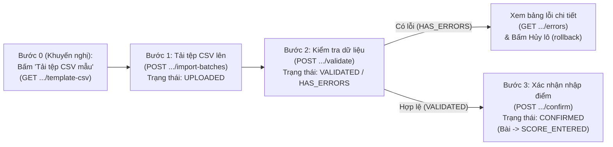

# Kế hoạch Thiết kế & Hiện thực UI cho F05b: Xuất CSV Mẫu & Nhập Điểm Theo Lô 3 Bước

> **Tài liệu Kế hoạch Kỹ thuật UI Angular** (đồng bộ với Backend v0.7 / ADR 0013 / ADR 0014).  
> **Dự án Frontend:** `LMS-UI` (Angular 21, TypeScript, Ng-Zorro-Antd, zoneless).  
> **Dự án Backend:** `LMS-API` (`AssessmentController#getScoreTemplateCsv`, `ImportBatchController`, `ImportBatchServiceImpl`).  
> **Căn cứ:** `doc/API-CONTRACT.md` §6.5, `LMS-API/doc/plan/F05b-nhap-diem.md`.

---

## 1. Phân quyền & Điều kiện Nghiệp vụ

| Hành động | Backend cho phép | UI hiện nút khi |
|---|---|---|
| Tải tệp CSV mẫu (`template-csv`) | Đọc được bài đánh giá (`ADMIN`, `PROGRAM_MANAGER`, `LECTURER` của lớp, `QA`) | Mọi vai trò được phép đọc khi bài ở trạng thái `LOCKED` hoặc `SCORE_ENTERED` |
| Tải lên lô điểm (`createBatch`), `validate`, `confirm`, `rollback` | Chỉ `LECTURER` của lớp (`canAccessSection` WRITE) | `LECTURER` của lớp; khóa nút nếu học kỳ không `OPEN`, lớp bị `LOCKED`, hoặc bài ở `DRAFT` |
| Xem lịch sử lô nhập & danh sách lỗi từng dòng | Đọc được lớp (`canAccessSection` READ) | Mọi vai trò được phép đọc |

---

## 2. Luồng Tương tác 3 Bước Chuẩn (Kèm Xuất Tệp Mẫu)

### Quy tắc UI quan trọng:
1. **Xuất tệp CSV mẫu (`GET /api/v1/assessments/{id}/scores/template-csv`):**
   - Tệp trả về dạng `Blob` (`text/csv; charset=UTF-8` có UTF-8 BOM nên Excel mở tiếng Việt không bị lỗi font).
   - Header chuẩn có dạng: `MaSV,HoTen,<item.code> - <clo.code> (Max: <maxScore>)` (ví dụ: `MaSV,HoTen,Q1 - CLO1 (Max: 4.0),Q1 - CLO2 (Max: 2.0)`).
   - Danh sách sinh viên `ENROLLED` đã được điền sẵn, ô điểm để trống.
2. **Tải tệp CSV lên (`POST /sections/{sectionId}/assessments/{assessmentId}/import-batches`):**
   - `multipart/form-data` gồm:
     - `file`: Tệp CSV đã nhập điểm (tối đa 5.000 dòng dữ liệu).
     - `reimportPolicy`: Mặc định gửi `'REJECT_ON_CONFLICT'`.
     - `sourceSystem`: `'CSV'` (mặc định) hoặc `'MOODLE_EXPORT'`.
     - `columnMapping`: **Tùy chọn**. Nếu giảng viên dùng đúng tệp CSV mẫu (hoặc giữ nguyên header `<itemCode> - <cloCode> ...`), UI **không cần bắt nhập mapping thủ công** (bỏ trống `columnMapping`) — Backend sẽ tự động nhận diện (`autoDetectMapping`) `MaSV` và toàn bộ các cột `<itemCode> - <cloCode>`. Nếu dùng tệp CSV tùy ý từ nguồn ngoài, UI hiển thị form cho phép giảng viên chọn cột tương ứng từng `(itemId, cloId)`.
3. **Kiểm tra (`validate`) & Xem lỗi (`errors`):**
   - Ngay sau khi `createBatch` trả về `201 UPLOADED`, UI có thể tự động (hoặc cho bấm nút) gọi `POST /import-batches/{id}/validate`.
   - Hiển thị `stats`: Tổng số dòng (`totalRows`), số dòng hợp lệ (`validRows`), số dòng lỗi (`errorRows`), tổng số điểm sẽ ghi (`scoreCount`).
   - Nếu `status === 'HAS_ERRORS'`: Gọi `GET /import-batches/{id}/errors?page=0&size=20` hiển thị bảng lỗi phân trang theo `rowNumber`, `column`, `errorType` (`SCORE_OUT_OF_RANGE`, `MISSING_FIELD`, `DUPLICATE_RECORD`, `INVALID_STUDENT_CODE`), `rawValue`, `message`. Khóa nút "Xác nhận", chỉ cho phép "Hủy lô (`rollback`)" để sửa tệp và tải lại.
4. **Xác nhận (`confirm`) & Hủy lô (`rollback`):**
   - Chỉ kích hoạt nút **"Xác nhận nhập điểm"** khi `status === 'VALIDATED'`.
   - Khi xác nhận thành công (`200 CONFIRMED`), cập nhật lại trạng thái bài đánh giá thành `SCORE_ENTERED`, hiển thị banner thành công và làm mới danh sách lịch sử lô nhập.

---

## 3. Route, Component & Service Dự Kiến

- **Route:** `/mng/sections/:sectionId/assessments/:assessmentId/score-import` (điều hướng từ nút **"Nhập điểm"** trên màn hình danh sách bài đánh giá của lớp hoặc màn chi tiết bài đánh giá khi bài ở `LOCKED` / `SCORE_ENTERED`).
- **Component:** `ScoreImportComponent` (gồm các khu vực: Stepper 3 bước `nz-steps`, nút tải CSV mẫu, khu vực Upload `nz-upload`, bảng Mapping cột tùy chọn cho tệp ngoài, bảng thống kê `stats` + bảng lỗi phân trang, và danh sách lịch sử các lô đã tải `GET .../import-batches`).
- **Service:** `src/app/core/services/assessment/score-import.service.ts` + Models `import-batch.model.ts`.
