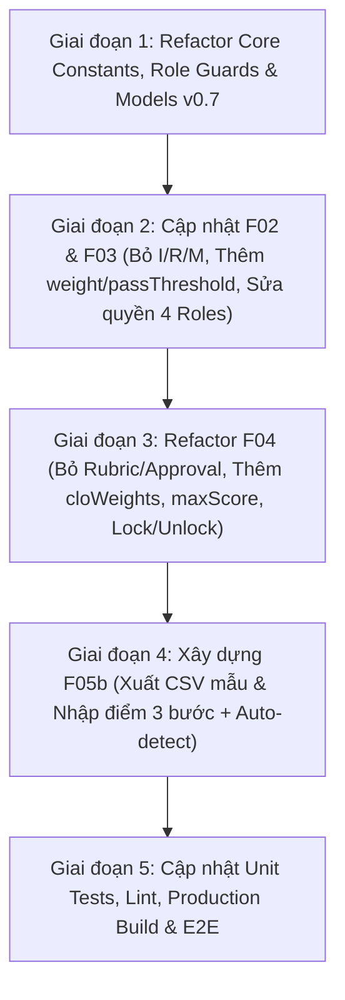

# Lộ Trình Cập Nhật & Tái Cấu Trúc LMS-UI theo Chuẩn OBE v0.7 & ADR 0014

> **Mục đích:** Tài liệu hướng dẫn kỹ thuật đầy đủ để cập nhật toàn bộ Frontend **LMS-UI** (Angular 21 + TypeScript) khớp 100% với Backend **LMS-API** (nhánh `refactor/v0.7-streamline-roles-and-docs`).  
> **Hợp đồng API chuẩn:** [`doc/API-CONTRACT.md`](file:///D:/Code/Project/LMS-UI/doc/API-CONTRACT.md)

---

## I. Tổng Hợp Thay Đổi So Với Hiện Trạng LMS-UI Cũ (Delta Analysis)

| Thành phần | Hiện trạng LMS-UI (Cũ) | Chuẩn mới Backend (v0.7 / ADR 0014) | Hành động bắt buộc trên LMS-UI |
|---|---|---|---|
| **1. Hệ thống Vai trò (`Role`)** | 7 vai trò (`ADMIN`, `PROGRAM_MANAGER`, `DEPARTMENT_HEAD`, `LECTURER`, `QA_OFFICER`, `VIEWER`, `STUDENT`) | **4 vai trò cốt lõi:** `ADMIN`, `PROGRAM_MANAGER`, `LECTURER`, `QA` | Xóa `DEPARTMENT_HEAD`, `VIEWER`, `QA_OFFICER`, `STUDENT` khỏi `SystemConstant.MNG_ROLE`, Guards, Menus, và các component/spec. Chuyển quyền duyệt đề cương & phân công GV sang `PROGRAM_MANAGER`; gộp quyền xem báo cáo & thẩm định CTĐT/CLO-PI vào `QA`. |
| **2. F02 — CTĐT, PLO, PI** | Còn I/R/M Matrix (`/pi-contributions`); thiếu `passThreshold` & `weight`; gộp `status` vào update metadata | Bỏ hoàn toàn I/R/M (ADR 0012); PLO bắt buộc `passThreshold`; PI bắt buộc `weight` & `passThreshold`; tách `PUT /program-versions/{id}/status` | Gỡ bỏ component/tab `irm-matrix-table` và API `/pi-contributions`. Thêm input `passThreshold` (PLO/PI) & `weight` (PI, tổng trong 1 PLO = 1.0). Tách nút/API đổi trạng thái phiên bản. |
| **3. F03 — Học phần, Đề cương, CLO** | Giao diện phân công GV viết đề cương nằm cả ở trang Admin; `clo_pi_links` có `weight` tùy chọn | `ADMIN` không có quyền biên soạn/duyệt đề cương hay gọi `/departments/assign-course`; `ADMIN` có thêm `POST /courses/import`; `clo_pi_links` **bắt buộc `weight`** | Gỡ nút phân công GV/duyệt đề cương khỏi `ADMIN`. Bổ sung nút Import CSV học phần trên `/mng/courses` cho `ADMIN`. Bắt buộc nhập `weight` ∈ `(0, 1]` trên ma trận CLO–PI. |
| **4. F04 — Trạng thái Bài đánh giá** | 6 trạng thái (`DRAFT`, `SUBMITTED`, `APPROVED`, `REJECTED`, `SCORE_ENTERED`, `LOCKED`) | **3 trạng thái:** `DRAFT`, `LOCKED`, `SCORE_ENTERED` | Xóa luồng `SUBMITTED`/`APPROVED`/`REJECTED`. Đổi sang luồng: `DRAFT` $\xrightarrow{\text{lock}}$ `LOCKED` $\xrightarrow{\text{unlock}}$ `DRAFT`, hoặc $\xrightarrow{\text{confirm F05b}}$ `SCORE_ENTERED`. |
| **5. F04 — Duyệt ma trận & Rubric** | Có `ReviewAssessmentComponent` (TBM duyệt/từ chối), `IRubric` (mức 1–4), `dataGranularity`, `totalPoints`, `weightInCourse` | **ĐÃ XÓA TOÀN BỘ** | Xóa bỏ màn hình/route duyệt đề của TBM (`/assessments/:id/review`), xóa model & UI Rubric mức 1–4, xóa các trường `totalPoints`, `weightInCourse`, `dataGranularity`. |
| **6. F04 — Câu hỏi & Trọng số CLO** | `outcomeMappings: [{ cloId, weight }]`; không có `cloWeights` | `outcomeMappings: [{ cloId, maxScore }]`; thêm **`cloWeights: [{ cloId, weight }]`** | Cập nhật `AssessmentItemModalComponent` nhập `maxScore` cho từng CLO trên câu hỏi (`bloomLevel` 1–6). Thêm bảng cấu hình `cloWeights` trên màn tạo/chi tiết bài đánh giá. |
| **7. F05b — Nhập điểm CSV 3 bước** | Chưa có giao diện nhập điểm & tải CSV mẫu | Đã có `GET .../scores/template-csv` + luồng 3 bước `import-batches` (`UPLOADED` $\to$ `validate` $\to$ `confirm`/`rollback`) + **tự động nhận diện header** | Xây dựng màn hình `ScoreImportComponent` theo [`F05b-nhap-diem-ui.md`](file:///D:/Code/Project/LMS-UI/doc/plan/F05b-nhap-diem-ui.md). |

---

## II. Lộ Trình Thực Hiện Chi Tiết (5 Giai Đoạn)



### Giai đoạn 1: Core Constants, Roles & Models
1. **Cập nhật `SystemConstant.MNG_ROLE` & Menus:**
   - Chỉ giữ 4 role: `ADMIN`, `PROGRAM_MANAGER`, `LECTURER`, `QA`.
   - Tìm và thay thế toàn bộ `QA_OFFICER` $\to$ `QA`, `VIEWER` $\to$ `QA`, xóa `DEPARTMENT_HEAD` và `STUDENT` trong routes, guards, menus, components và tests.
2. **Cập nhật Models (`src/app/core/models/`):**
   - `assessment.model.ts`:
     - `AssessmentStatus = 'DRAFT' | 'LOCKED' | 'SCORE_ENTERED'`.
     - Xóa `IRubric`, `IRubricLevel`, `IApproval`, `IApprovalHistoryEntry`, `ItemKind`, `DataGranularity`.
     - `IOutcomeMapping`: `{ cloId: string; maxScore: number }`.
     - `IAssessmentCloWeight`: `{ cloId: string; weight: number }`.
     - `IAssessmentItem`: `{ id?: string; code: string; orderIndex?: number; bloomLevel: number; outcomeMappings: IOutcomeMapping[] }`.
     - `IAssessment`: `{ id, syllabusId, sectionId?, templateId?, code, name, scope, type, phase, scheduledAt?, status, locked, cloWeights, coverageSummary?, items, revision }`.
   - `plo-pi.model.ts` & `clo.model.ts`:
     - `IPloRequest`: bổ sung `passThreshold: number`.
     - `IPiRequest`: bổ sung `passThreshold: number`, `weight: number`.
     - `ICloPiLinkRequest`: `weight: number` (bắt buộc).
   - `import-batch.model.ts` (mới): `ImportBatchStatus` (`UPLOADED`, `VALIDATED`, `HAS_ERRORS`, `CONFIRMED`, `ROLLED_BACK`), `IImportBatch`, `IImportColumnMapping`, `IImportRowError`.

### Giai đoạn 2: Cập nhật Phân hệ F02 & F03
1. **F02 (`curriculum/`):**
   - Gỡ bỏ `irm-matrix-table` và `CoursePiContributionService`.
   - Trong `form-curriculum-version`: Thêm trường nhập `passThreshold` cho PLO; thêm `weight` và `passThreshold` cho PI (kèm validator kiểm tra tổng `weight` các PI trong 1 PLO = `1.0`).
   - Đổi `PUT /program-versions/{id}` chỉ cập nhật metadata; dùng `PUT /program-versions/{id}/status` khi đổi trạng thái `DRAFT`/`ACTIVE`/`ARCHIVED`.
   - Kích hoạt nút duyệt ĐBCL (`verification`) cho role `QA`.
2. **F03 (`courses/` & `syllabi/`):**
   - `list-courses`: Bổ sung nút/modal nhập danh mục học phần CSV (`POST /api/v1/courses/import`) dành riêng cho `ADMIN`.
   - `syllabi`: Giao quyền phân công giảng viên (`/departments/assign-course`) và duyệt đề cương (`PUT /syllabi/{id}/status`) cho `PROGRAM_MANAGER`; ẩn hoàn toàn với `ADMIN`.
   - `clo-pi-matrix`: Bắt buộc nhập `weight` ∈ `(0, 1]` khi tạo liên kết; quyền thẩm định liên kết thuộc `QA`.

### Giai đoạn 3: Refactor Phân hệ Bài Đánh Giá F04 (`assessments/`)
1. Xóa `review-assessment/` và route `/mng/assessments/:id/review`.
2. Cập nhật `AssessmentService`: xóa `submit`, `approve`, `reject`; bổ sung `lock(id)`, `unlock(id)`, `deleteAssessment(id)`, `downloadScoreTemplateCsv(id)`.
3. Cập nhật `AssessmentItemModalComponent`: bỏ tab/form Rubric, bỏ `kind`/`title`/`topic`/`externalRef`/`maxScore` tổng; chỉ giữ `code`, `bloomLevel` (1–6), và bảng gán nhiều CLO kèm `maxScore` riêng cho từng CLO.
4. Cập nhật `AssessmentCreateModalComponent` & `DetailAssessmentComponent`:
   - Bỏ `totalPoints`, `weightInCourse`, `dataGranularity`.
   - Thêm bảng cấu hình `cloWeights` (tỷ trọng đóng góp của bài cho từng CLO).
   - Thay thanh tác vụ: nút **"Khóa ma trận"** (`lock`) khi `DRAFT`, nút **"Mở khóa"** (`unlock`) và nút **"Nhập điểm"** (dẫn tới F05b) khi `LOCKED`.

### Giai đoạn 4: Xây dựng Phân hệ Nhập Điểm F05b
- Hiện thực đầy đủ theo [`doc/plan/F05b-nhap-diem-ui.md`](file:///D:/Code/Project/LMS-UI/doc/plan/F05b-nhap-diem-ui.md):
  - Nút tải tệp CSV mẫu (`GET /assessments/{id}/scores/template-csv`).
  - Upload tệp CSV (mặc định không cần gửi `columnMapping` khi dùng tệp mẫu vì Backend có `autoDetectMapping`; hỗ trợ cấu hình mapping thủ công nếu upload tệp ngoài).
  - Stepper 3 bước: Tải lên (`UPLOADED`) $\to$ Kiểm tra (`validate`) & xem bảng lỗi phân trang (`errors`) $\to$ Xác nhận (`confirm`) hoặc Hủy lô (`rollback`).

### Giai đoạn 5: Kiểm Chứng Chất Lượng (CI Gatekeeper)
```bash
cd D:\Code\Project\LMS-UI
npm run lint          # Phải đạt 0 lỗi ESLint
npm run test:ci       # Toàn bộ *.spec.ts pass 100%, coverage >= ngưỡng
npm run build         # Production build 0 lỗi (không vượt CSS budget)
```
